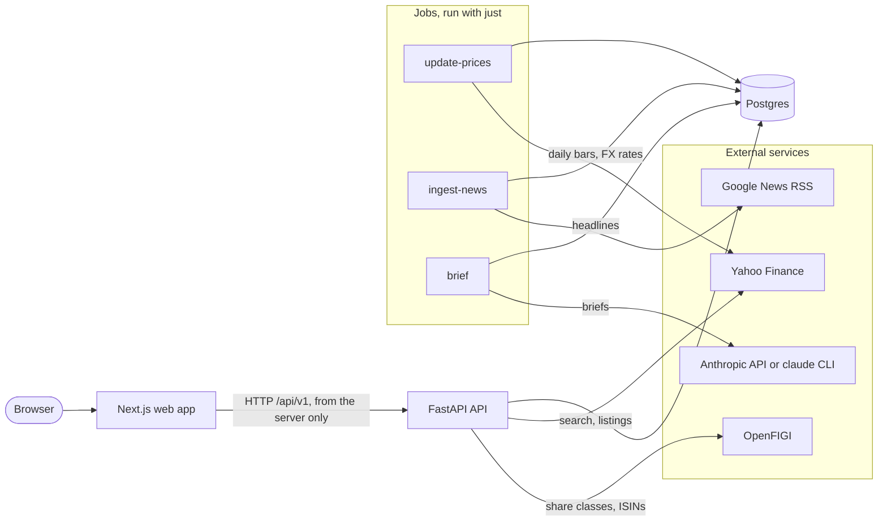

# Baseline

[](https://github.com/romancxx/stock-news-v2/actions/workflows/api.yml)
[](https://github.com/romancxx/stock-news-v2/actions/workflows/web.yml)

A news reader for the stocks you hold: daily prices, headlines, and a short brief per stock written by Claude, citing its sources.
Not investment advice.

## Screenshots

<!-- Screenshots go here. -->

## What it does

- **Portfolio**: add holdings by search, or import a broker export as CSV by ISIN, with a dry run and a report per row.
- **Prices**: daily closes from Yahoo Finance and FX rates, so the overview values every holding and totals them in one base currency.
- **News**: the last day's headlines of each stock from Google News, with junk pages, off-topic items and duplicates dropped.
- **Briefs**: a few sentences per stock on what was reported, with a tone and the headlines it cites, written by Claude and checked in code.

## Architecture



The browser only talks to the web app; the web app's server calls the API, whose OpenAPI schema generates the web app's types.
Prices, news and briefs are written by commands run by hand, not by the API.

## Stack

| Part | Built with |
| --- | --- |
| Web ([`apps/web/`](apps/web/README.md)) | Next.js (App Router), React, TypeScript (strict), Tailwind CSS, Zod, openapi-fetch, Recharts, Biome, Vitest, pnpm |
| API ([`apps/api/`](apps/api/README.md)) | Python 3.13, FastAPI, Pydantic, SQLAlchemy 2 (async, asyncpg), Alembic, structlog, ruff, pyright (strict), pytest, uv |
| Database | Postgres 18 with pg_trgm, in Docker Compose |
| Data sources | Yahoo Finance (yfinance), OpenFIGI, Google News RSS, Claude through the Anthropic API or the `claude` CLI |
| Tooling | just, lefthook, GitHub Actions |

## Quickstart

Needs [uv](https://docs.astral.sh/uv/), [pnpm](https://pnpm.io/), Node 22, [just](https://just.systems/) and Docker.

```sh
git clone https://github.com/romancxx/stock-news-v2.git && cd stock-news-v2
cp apps/api/.env.example apps/api/.env
# In apps/api/.env: set JWT_SECRET to the output of `openssl rand -hex 32`, and either
# ANTHROPIC_API_KEY, or LLM_BACKEND=cli with the `claude` CLI logged in.
cp apps/web/.env.example apps/web/.env.local
just api-install
pnpm --dir apps/web install
just hooks-install
just dev
```

`just dev` starts Postgres, applies the migrations, and serves the API on <http://localhost:8000> and the web app on <http://localhost:3000>.
Create an account, add or import holdings, then fill in their data from a second terminal:

```sh
just update-prices   # daily prices and FX rates
just ingest-news     # the last day's headlines
just brief           # a brief per stock with new headlines
```

`just` alone lists every command.

## Repository

| Path | Contents |
| --- | --- |
| [`apps/api/`](apps/api/README.md) | The backend: endpoints, jobs, settings and migrations; its [code standards](apps/api/CODE_STANDARDS.md) and [decision records](apps/api/docs/adr/README.md) |
| [`apps/web/`](apps/web/README.md) | The frontend: its [code standards](apps/web/CODE_STANDARDS.md) and [decision records](apps/web/docs/adr/README.md) |
| [`GLOSSARY.md`](GLOSSARY.md) | The domain vocabulary both apps share |
| `justfile` | Every command, run from the repository root |
| `docker-compose.yml` | The API's Postgres |

Each source's terms, and what Baseline does with its data, are in the [API's README](apps/api/README.md#data-sources-and-terms).

## License

MIT, see [LICENSE](LICENSE).
