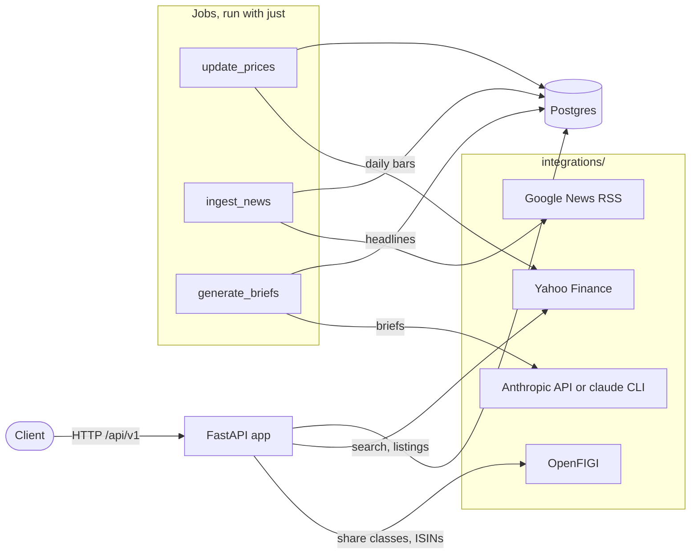

# Baseline API

[](https://github.com/romancxx/baseline/actions/workflows/api.yml)

The backend of a news reader for the stocks you hold.
It keeps your portfolio, fetches each stock's daily prices from Yahoo Finance and its headlines from Google News, and has Claude write a short brief per stock that cites the headlines it was written from.

A brief, as stored on 2 November 2026:

> **ASML Holding N.V.** (ASML.AS) · tone: mixed
>
> TIKR.com reports ASML fell 6% in Intel's chip rout, while CEO says supply "will not fully meet the demand."
> marketscreener.com reports Jefferies is Neutral on the company.
> Simply Wall St and Yahoo Finance published pieces on executive pay tied to employee morale and on whether the shares are undervalued or fairly valued after a pullback and a 149% run.
> TradingKey published a piece calling ASML a buy after a Terafab deal.
>
> From 5 articles, 1-2 Nov, generated 2026-11-02 15:10 UTC.
> _Describes news as reported. Not investment advice._

| Published (UTC) | Publisher          | Headline cited                                                                          |
| --------------- | ------------------ | --------------------------------------------------------------------------------------- |
| 2 Nov, 13:30    | TIKR.com           | ASML Fell 6% in Intel's Chip Rout. Its CEO Says Supply "Will Not Fully Meet the Demand" |
| 2 Nov, 12:20    | marketscreener.com | ASML Holding N.V. : Jefferies is Neutral                                                |
| 1 Nov, 17:08    | Yahoo Finance      | Why Is ASML Holding (NasdaqGS:ASML) Tying Executive Pay To Employee Morale?             |
| 1 Nov, 16:05    | Yahoo Finance      | ASML (NasdaqGS:ASML) Stock Looks Fairly Valued On Its 149% Run                          |
| 1 Nov, 15:24    | TradingKey         | Why ASML is a buy After Terafab Deal?                                                   |

## Architecture



## Quickstart

Needs [uv](https://docs.astral.sh/uv/), [just](https://just.systems/), Docker and `jq`.

```sh
git clone https://github.com/romancxx/baseline.git && cd baseline
cp apps/api/.env.example apps/api/.env
# In apps/api/.env: set JWT_SECRET to the output of `openssl rand -hex 32`, and either
# ANTHROPIC_API_KEY, or LLM_BACKEND=cli with the `claude` CLI logged in.
just db-up
just api-install
just hooks-install
uv --directory apps/api run alembic upgrade head
just api-dev
```

In a second terminal, register, follow a stock, then fetch its news and write its brief:

```sh
API=http://localhost:8000/api/v1
curl -s $API/auth/register -H 'Content-Type: application/json' \
  -d '{"email": "me@example.com", "password": "correct-horse-battery"}'
TOKEN=$(curl -s $API/auth/login --data-urlencode username=me@example.com \
  --data-urlencode password=correct-horse-battery | jq -r .access_token)
AUTH="Authorization: Bearer $TOKEN"
INSTRUMENT=$(curl -s $API/instruments/resolve -H "$AUTH" -H 'Content-Type: application/json' \
  -d '{"yahoo_symbol": "ASML.AS"}' | jq -r .id)
curl -s $API/portfolio/positions -H "$AUTH" -H 'Content-Type: application/json' \
  -d "{\"instrument_id\": \"$INSTRUMENT\"}"

just ingest-news
just brief
curl -s $API/instruments/$INSTRUMENT/brief -H "$AUTH" | jq
```

The interactive docs are at <http://localhost:8000/docs>.

## Key design decisions

- [0001](docs/adr/0001-project-and-tooling.md): uv, a `src/` layout, ruff, strict pyright and pytest, run through a root `justfile` and GitHub Actions.
- [0002](docs/adr/0002-api-architecture.md): one package per feature, each external service behind its own client in `integrations/`, imports going one way.
- [0003](docs/adr/0003-api-conventions.md): domain errors with one error shape, structured logs with request IDs, keyset pagination, decimals as JSON strings, tests on a real Postgres.
- [0004](docs/adr/0004-database-and-migrations.md): Postgres 18 through async SQLAlchemy, with reviewed Alembic migrations tested up and down.
- [0005](docs/adr/0005-authentication.md): Argon2id passwords, 15-minute JWTs, single-use refresh tokens in an httpOnly cookie; another user's rows answer 404.
- [0006](docs/adr/0006-instruments.md): one instrument per Yahoo symbol, grouped into share classes by FIGI, searched with pg_trgm.
- [0007](docs/adr/0007-market-data.md): Yahoo Finance through yfinance, as `Decimal` prices; daily bars upserted per instrument and day, and daily FX rates into `BASE_CURRENCY`.
- [0008](docs/adr/0008-security-identifiers.md): OpenFIGI for share class FIGIs and ISIN lookups, behind one rate-limited client.
- [0009](docs/adr/0009-portfolios.md): one portfolio per user, created at registration, a CSV import by ISIN with a per-row report and a dry run, and an overview valuing every position.
- [0010](docs/adr/0010-news-ingestion.md): Google News RSS behind a `NewsSource` protocol, and one brief per security, checked in code, citing its headlines.
- [0011](docs/adr/0011-local-llm-backend.md): briefs from the Anthropic API or the local `claude` CLI, chosen by `LLM_BACKEND`.

## Data sources and terms

Baseline is a personal project, meant to be run for your own use.
Each source has its own terms; read them before using the data any other way.

| Source                                                                    | Used for                                                      | Terms                                                                                                                                                                                          |
| ------------------------------------------------------------------------- | ------------------------------------------------------------- | ---------------------------------------------------------------------------------------------------------------------------------------------------------------------------------------------- |
| Yahoo Finance, through [yfinance](https://github.com/ranaroussi/yfinance) | Search, listing details, daily prices                         | yfinance is not affiliated with Yahoo; its README notes Yahoo's API is meant for personal use only. [Yahoo terms](https://legal.yahoo.com/us/en/yahoo/terms/otos/index.html)                   |
| [OpenFIGI](https://www.openfigi.com/)                                     | Share class FIGIs, ISIN lookups                               | [OpenFIGI terms of service](https://www.openfigi.com/docs/terms-of-service)                                                                                                                    |
| Google News RSS                                                           | Headlines and links; articles stay on their publishers' sites | [Google terms of service](https://policies.google.com/terms)                                                                                                                                   |
| Anthropic                                                                 | Writing the briefs                                            | [Commercial terms](https://www.anthropic.com/legal/commercial-terms) with an API key; [consumer terms](https://www.anthropic.com/legal/consumer-terms) with the `claude` CLI on a subscription |

## Configuration

Settings are read from environment variables, then from `.env`, which starts as a copy of `.env.example`.
`JWT_SECRET` takes the output of `openssl rand -hex 32`.
`OPENFIGI_API_KEY` is optional: without it, OpenFIGI allows 25 requests per minute instead of 250.
Briefs need a model: `ANTHROPIC_API_KEY` for the Anthropic API, or else the `claude` CLI on the PATH, logged in to a Claude subscription.
`LLM_BACKEND` picks one: `api` (the default) or `cli`; set `cli` on your own machine to use the subscription.
Without the chosen backend, news has headlines but no briefs.
`ANTHROPIC_MODEL` picks the model for both (`claude-haiku-5-5` by default).
The API reads only this key, not an `ant auth login` profile; the CLI never sees the key.
`BASE_CURRENCY` is the ISO 4217 code FX rates convert into (`EUR` by default); after changing it, empty the `fx_rates` table and run `just update-prices` again.

Postgres runs in Docker and reads its credentials from the same `.env`. From the repo root,
`just db-up` starts it and waits until it is healthy; `just db-down` stops it and keeps the data.

## Development

From the repo root:

| Task       | Command              |
| ---------- | -------------------- |
| Install    | `just api-install`   |
| Dev server | `just api-dev`       |
| Format     | `just api-format`    |
| Lint       | `just api-lint`      |
| Type-check | `just api-typecheck` |
| Test       | `just api-test`      |
| Schema     | `just api-openapi`   |

`just api-lint` runs `ruff check` and `ruff format --check`.
`just api-openapi` writes the OpenAPI schema to `openapi.json`, committed so the web app's types are generated from it; it needs no database.
GitHub Actions runs lint, the format check, pyright and the tests on each push and pull request that touches `apps/api/`, then fails if `openapi.json` differs from the code's schema.

`just yahoo-search "MSCI World"` searches the real Yahoo Finance and prints each stock or ETF
found with its exchange code and currency. It is the only command that calls Yahoo; tests
never do.

`just news-search "ASML Holding N.V."` searches the real Google News the way ingestion does:
the name without its legal form, finance terms, the last day, junk dropped. It prints the query,
each article (time, publisher, headline) and what was dropped. Tests never call Google News:
they read real feeds, recorded and trimmed, from `tests/fixtures/google_news/`.

Tests need Postgres running.
Each run recreates a separate `baseline_test` database, migrates it to head, and migrates it back to base at the end; the development database is not touched.
`just api-test` sets the test `DATABASE_URL` and `JWT_SECRET`; CI sets its own.
A test that connects to anything but the local Postgres fails.

## Migrations

Alembic manages the schema. Run from `apps/api/` with Postgres up:

| Task                         | Command                                              |
| ---------------------------- | ---------------------------------------------------- |
| Apply all pending migrations | `uv run alembic upgrade head`                        |
| Generate a migration         | `uv run alembic revision --autogenerate -m "<what>"` |
| Create an empty migration    | `uv run alembic revision -m "<what>"`                |
| Roll back the last migration | `uv run alembic downgrade -1`                        |
| Roll back everything         | `uv run alembic downgrade base`                      |
| Show the applied revision    | `uv run alembic current`                             |
| Show the revision chain      | `uv run alembic history`                             |
| Print SQL instead of running | `uv run alembic upgrade head --sql`                  |

Generated files go to `migrations/versions/` and are linted and formatted by ruff on creation.

## Endpoints

Every path starts with `/api/v1`.
The full schema, with every field, is at <http://localhost:8000/docs>, and is committed as [`openapi.json`](openapi.json); why each endpoint behaves as it does is in its ADR.

| Endpoint                                                                        | What it does                                                                                       | ADR                                      |
| ------------------------------------------------------------------------------- | -------------------------------------------------------------------------------------------------- | ---------------------------------------- |
| `GET /health`                                                                   | Whether the database answers (200 or 503)                                                          | [0003](docs/adr/0003-api-conventions.md) |
| `POST /auth/register`                                                           | Create an account, with its portfolio                                                              | [0005](docs/adr/0005-authentication.md)  |
| `POST /auth/login`                                                              | Sign in with a form (`username` is the email); returns an access token and sets the refresh cookie | [0005](docs/adr/0005-authentication.md)  |
| `POST /auth/refresh`, `POST /auth/logout`                                       | Rotate or revoke the refresh cookie                                                                | [0005](docs/adr/0005-authentication.md)  |
| `GET /users/me`                                                                 | The signed-in user                                                                                 | [0005](docs/adr/0005-authentication.md)  |
| `GET /instruments`, `GET /instruments/{id}`                                     | Stored listings, paginated and filterable, or one                                                  | [0006](docs/adr/0006-instruments.md)     |
| `GET /instruments/search?q=`                                                    | Stored listings by ISIN, symbol or name, then Yahoo's when few match                               | [0006](docs/adr/0006-instruments.md)     |
| `POST /instruments/resolve`                                                     | Store a Yahoo symbol (201), or return it if stored (200)                                           | [0006](docs/adr/0006-instruments.md)     |
| `GET /instruments/{id}/prices?from=&to=`                                        | Daily bars of a date range, oldest first                                                           | [0007](docs/adr/0007-market-data.md)     |
| `GET /instruments/{id}/news`                                                    | The share class's articles, newest first, paginated                                                | [0010](docs/adr/0010-news-ingestion.md)  |
| `GET /instruments/{id}/brief`                                                   | The share class's latest brief, or 404                                                             | [0010](docs/adr/0010-news-ingestion.md)  |
| `GET /portfolio`                                                                | The signed-in user's portfolio                                                                     | [0009](docs/adr/0009-portfolios.md)      |
| `POST`, `GET /portfolio/positions`; `PATCH`, `DELETE /portfolio/positions/{id}` | Add, list, update and remove positions                                                             | [0009](docs/adr/0009-portfolios.md)      |
| `GET /portfolio/overview`                                                       | Every position valued at its latest close, and the totals in `BASE_CURRENCY`                       | [0009](docs/adr/0009-portfolios.md)      |
| `POST /portfolio/import?dry_run=`                                               | Add or update positions from a CSV ([format below](#importing-positions))                          | [0009](docs/adr/0009-portfolios.md)      |
| `GET /portfolio/briefs`                                                         | The latest brief of each security held                                                             | [0010](docs/adr/0010-news-ingestion.md)  |

Every endpoint but health and `/auth` needs `Authorization: Bearer <access_token>`; in `/docs`, **Authorize** signs in for you.
Errors answer `{code, message, details}`, decimals are JSON strings, and lists are pages of `items` with a `next_cursor` to pass back as `cursor`.

## Jobs

Prices, news and briefs are written by commands run by hand from the repo root, not by the API.
Each covers every security held in any portfolio, carries on when one fails, and ends with one log line summarising the run.

| Command              | What it does                                                                                        | ADR                                                                                 |
| -------------------- | --------------------------------------------------------------------------------------------------- | ----------------------------------------------------------------------------------- |
| `just update-prices` | Daily bars from Yahoo Finance (the full history the first time), then FX rates into `BASE_CURRENCY` | [0007](docs/adr/0007-market-data.md)                                                |
| `just ingest-news`   | The last day's Google News headlines of every stock; articles older than 30 days are deleted        | [0010](docs/adr/0010-news-ingestion.md)                                             |
| `just brief`         | A brief per stock with new headlines, through `LLM_BACKEND`                                         | [0010](docs/adr/0010-news-ingestion.md), [0011](docs/adr/0011-local-llm-backend.md) |

## Importing positions

`POST /api/v1/portfolio/import` takes a CSV file in the multipart field `file` and adds a position to your portfolio for each row, or updates the one already there.
With `?dry_run=true`, it returns the same report and writes nothing.
Each ISIN not stored yet is looked up on OpenFIGI and Yahoo, which takes a second or more per row (longer without `OPENFIGI_API_KEY`).

### File format

This section is written to be handed to an AI, along with a broker export, to convert it.

- UTF-8 text, at most 64 KiB, comma-separated, with a header row first.
- One row per position: an ISIN appears only once in a file.
- Numbers use a dot as the decimal separator and no thousands separator: `1234.5`, never
  `1,234.50` or `1234,5`. At most 8 decimal places.
- The columns below, in any order. Only `isin` is required; any other column makes the whole
  file rejected.

| Column          | Required                    | Content                                                          |
| --------------- | --------------------------- | ---------------------------------------------------------------- |
| `isin`          | yes                         | The security's 12-character ISIN, e.g. `FR0000121014`.           |
| `quantity`      | no                          | Number of shares or units held, greater than 0.                  |
| `average_price` | no                          | Average purchase price per share, greater than 0, in `currency`. |
| `currency`      | when `average_price` is set | ISO 4217 code of the listing bought: `EUR`, `USD`, `GBP`…        |

`currency` also chooses the listing: the same S&P 500 ETF is CSPX.L in `USD` and CSP1.L in
`GBP`. Without it, the issuer's home exchange is preferred (Paris for an `FR` ISIN), then Paris,
Amsterdam, Xetra, London, the US and Hong Kong. On a position already there, an empty cell
clears that value and a column left out of the file leaves it unchanged.

```csv
isin,quantity,average_price,currency
FR0000121014,10,650.50,EUR
IE00B5BMR087,4.5,512.30,USD
US0378331005,25,,
```

### Report

```json
{
  "dry_run": false,
  "rows": [
    {
      "line": 2,
      "isin": "FR0000121014",
      "status": "imported",
      "symbol": "MC.PA",
      "alternatives": ["MOH.DE", "LVMHF"],
      "message": null
    }
  ]
}
```

`line` is the row's line in the file (the header is line 1), and `alternatives` lists up to 3
other listings of the ISIN. A bad row does not stop the others.

| Status              | Meaning                                                                                     |
| ------------------- | ------------------------------------------------------------------------------------------- |
| `imported`          | A position was added.                                                                       |
| `updated`           | The portfolio already held this instrument; its position was updated.                       |
| `not_found`         | No listing of the ISIN on Yahoo Finance trades in the expected currency.                    |
| `invalid`           | The row breaks the format; `message` says how.                                              |
| `currency_mismatch` | The ISIN's stored listing trades in another currency, and no other one trades in the row's. |

A file that breaks the format as a whole (not UTF-8, unknown, missing or repeated columns)
answers 422 with code `invalid_file`; a file over 64 KiB answers 413 (`file_too_large`).

## Project layout

```
alembic.ini        # Alembic config; the database URL comes from Settings
migrations/
├── env.py         # connects Alembic to Settings and Base.metadata
└── versions/      # one file per revision
scripts/           # commands run by hand, such as yahoo_search.py
src/app/
├── main.py        # create_app(): builds the FastAPI app and mounts module routers
├── core/          # app-wide code shared by all modules (settings, database, errors, logging)
├── jobs/          # commands run outside FastAPI, e.g. python -m app.jobs.update_prices
├── integrations/
│   └── <provider>/ # one client per external service: client.py, schemas.py, dependencies.py
└── modules/
    └── <feature>/ # one package per feature
```

Imports go one way, `main` and `jobs` → `modules` → `integrations` → `core`, and lint fails on the other direction ([0002](docs/adr/0002-api-architecture.md)).

## Further reading

- [docs/adr/](docs/adr/README.md): why the API is built the way it is, one record per topic.
- [CODE_STANDARDS.md](CODE_STANDARDS.md): the rules for writing code here.
- [docs/improvements.md](docs/improvements.md): known shortcuts, and when each becomes worth fixing.

## License

MIT, see [LICENSE](../../LICENSE).
